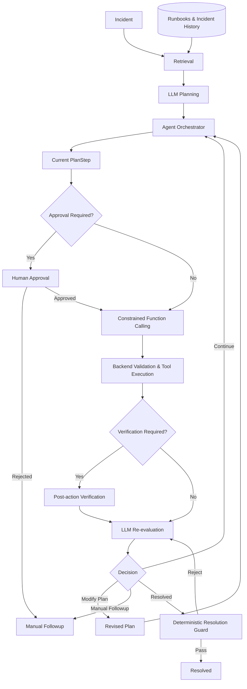
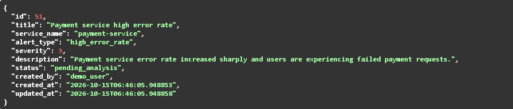
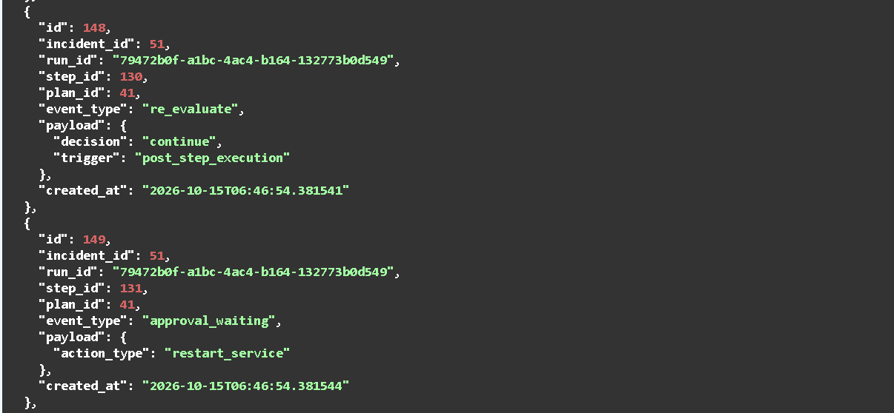
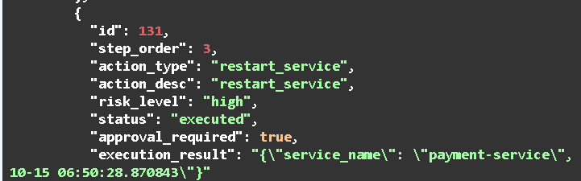
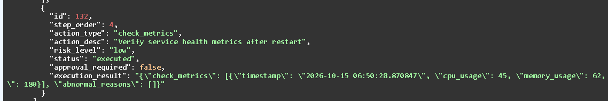
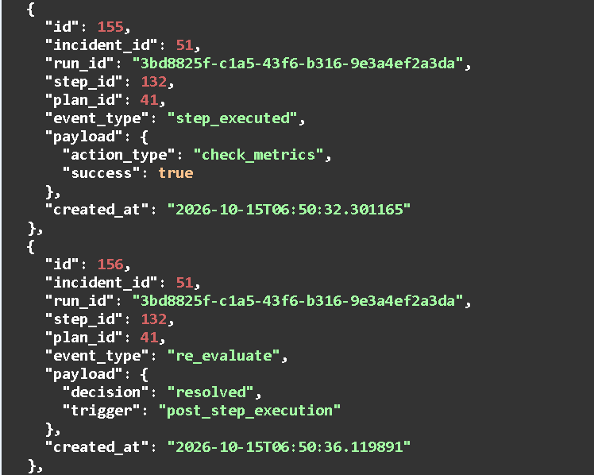
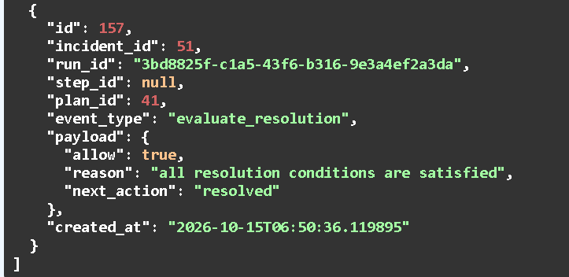
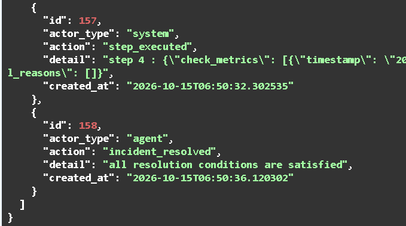

# AI SRE Incident Response Agent

> **A production-style LLM agent for safe and auditable incident remediation.**  
> **LLM for intelligence. Backend for control.**


An AI-powered incident response system that retrieves operational knowledge, generates remediation plans, executes constrained tools, and continuously re-evaluates incident state.

Unlike fully autonomous Agent demos, the LLM **does not own operational authority**.  
High-risk actions require human approval, tool calls are constrained by the backend, restart operations require post-execution verification, and final resolution is protected by deterministic backend rules.

---

## Why This Project?

A typical Agent demo often looks like:

**Prompt → LLM → Tool → Result**

This project focuses on a harder engineering problem:

> **How can an LLM participate in infrastructure operations without giving it unrestricted control?**

| LLM Intelligence | Backend Control |
|---|---|
| Understand incident context | Control state transitions |
| Generate remediation plans | Restrict available tools |
| Select meaningful tool arguments | Validate and inject trusted arguments |
| Re-evaluate execution results | Enforce approval and verification |
| Suggest the next action | Decide whether resolution is actually allowed |

The core principle is simple:

### **The LLM proposes. The backend enforces.**

---

## Architecture



### Observability

**Trace** records *why* an Agent run followed a particular path.  
**Audit** records *who* performed important operations and *what* state changed.

---

## Core Engineering Highlights

### Retrieval-Augmented Reasoning

Incident context is grounded with relevant **Runbooks** and **Historical Incidents** using:

**Structured filtering → Embedding retrieval → CrossEncoder reranking → Top-K evidence**

This evidence is reused by both initial planning and later re-evaluation.

### Constrained Function Calling

The LLM cannot freely choose any tool.

Each `PlanStep` already determines the permitted action, while Gemini only generates arguments for that specific tool.

**FunctionCall → Pydantic Validation → Trusted Argument Injection → Tool Registry → Execution**

Sensitive context such as `service_name` and `restart_time` remains backend-controlled.

### Human-in-the-loop Safety

High-risk operations such as `restart_service` enter `WAITING_APPROVAL`.

They cannot execute until explicitly approved, while rejected operations move the incident to `MANUAL_FOLLOWUP`.

### Post-execution Verification

A successful command does **not** mean the incident is resolved.

After `restart_service`, the Agent automatically inserts a `check_metrics` verification step to evaluate actual post-restart service health.

### Deterministic Resolution Guard

The LLM may **suggest** `resolved`, but cannot directly change the Incident to `RESOLVED`.

The backend verifies that:

- no required Step is failed, rejected, pending, or awaiting approval;
- required verification has completed;
- verification results show no abnormal conditions;
- no unresolved control action remains.

Only then can the Incident become `RESOLVED`.

### Plan Revision & Versioning

When execution evidence invalidates the current plan:

**Plan v1 → SUPERSEDED**  
**Plan v2 → GENERATED**

Historical plans remain available for traceability instead of being deleted.

---

## Demo

The following example shows a complete incident lifecycle, from incident creation to human-approved remediation, post-action verification, and deterministic resolution.

### 1. Incident Created

A new `payment-service` incident is created after detecting a high error rate.



---

### 2. Agent Pauses for Human Approval

The agent continues its investigation until it reaches the high-risk `restart_service` step.  
Because the action requires approval, the orchestrator pauses instead of executing it automatically.



---

### 3. Approved High-risk Restart

After human approval, the agent resumes and executes the `restart_service` step.



---

### 4. Automatic Post-restart Verification

A successful restart is not treated as incident resolution.

The agent automatically executes a `check_metrics` verification step to confirm that the service has actually recovered.



---

### 5. Re-evaluation & Deterministic Resolution Guard

After verification succeeds, the LLM re-evaluates the incident and proposes that it is resolved.



However, the LLM cannot directly mark the incident as resolved.

The backend independently validates the current execution state and verification evidence through the deterministic resolution guard.



---

### 6. Incident Resolved

Only after all backend resolution conditions are satisfied can the incident enter the final `RESOLVED` state.




---

## Tech Stack

| Area | Technologies |
|---|---|
| Backend | Python, FastAPI |
| Data Layer | SQLAlchemy |
| Validation | Pydantic |
| LLM | Gemini Native Function Calling |
| Retrieval | SentenceTransformer |
| Reranking | CrossEncoder |
| Agent Control | State Machine, Tool Registry |
| Safety | Human Approval, Verification, Resolution Guard |
| Observability | Trace, Audit Log |
| Testing | pytest |

---


## Quick Start

### Prerequisites

- Python 3.10+
- pip
- A Gemini API key
- Internet access for Gemini API calls and initial model downloads

### 1. Clone the Repository

```bash
git clone https://github.com/YOUR_USERNAME/YOUR_REPOSITORY.git
cd YOUR_REPOSITORY
```

Replace the repository URL and directory name with your actual GitHub repository information.

### 2. Set Up the Python Environment

Create a virtual environment:

```bash
python -m venv .venv
```

Activate the environment.

**Windows (PowerShell):**

```powershell
.\.venv\Scripts\Activate.ps1
```

**macOS / Linux:**

```bash
source .venv/bin/activate
```

Install the required dependencies:

```bash
python -m pip install -r requirements.txt
```

### 3. Configure Environment Variables

Copy the configuration template to create your local `.env` file.

**Windows (PowerShell):**

```powershell
Copy-Item .env.example .env
```

**macOS / Linux:**

```bash
cp .env.example .env
```

Open `.env` and update the configuration:

```dotenv
DATABASE_URL=sqlite:///./test.db
GEMINI_API_KEY=your_actual_gemini_api_key
GEMINI_MODEL=gemini-2.5-flash
```

Replace `your_actual_gemini_api_key` with your own Gemini API key.

The application loads these settings through `pydantic-settings`.

**Security:** Do not commit `.env`, API keys, or local database files to version control.

### 4. Start the FastAPI Server

From the project root, run:

```bash
uvicorn main:app --reload
```

The application initializes the SQLite database tables using SQLAlchemy's `Base.metadata.create_all()`.

Open the interactive API documentation:

**Swagger UI:** http://127.0.0.1:8000/docs

### 5. Initialize Sample Knowledge Data

For a new database, open a second terminal in the project directory and run:

```bash
python seed_data.py
```

The script inserts sample operational knowledge into the database:

- Payment service and authentication service Runbooks
- Historical payment service incidents and resolution records

These records provide retrieval evidence for incident planning and re-evaluation.

**Note:** Run the seed script only once for a fresh database. Repeated execution will insert duplicate sample records.

### 6. Create an Incident

Open Swagger UI and find:

`POST /incidents/`

Submit the following example request:

```json
{
  "title": "Payment service high error rate",
  "service_name": "payment-service",
  "alert_type": "high_error_rate",
  "severity": 3,
  "description": "Payment service error rate increased sharply and users are experiencing failed payment requests.",
  "created_by": "demo_user"
}
```

The API returns a new Incident with a unique ID and an initial `pending_analysis` status.

### 7. Run the Agent

Start incident processing using:

`POST /incidents/{incident_id}/run`

The Agent:

1. Retrieves relevant Runbooks and historical incidents.
2. Generates a structured remediation Plan.
3. Executes permitted low-risk diagnostic tools.
4. Pauses when a high-risk action requires human approval.

### 8. Approve a High-risk Action

If a `restart_service` step enters `waiting_approval`, call:

`POST /steps/{step_id}/approve`

Request body:

```json
{
  "approved": true
}
```

The API resumes Agent execution after approval.

The Agent can then execute the approved action, perform post-restart health verification, and re-evaluate the Incident.

### 9. Inspect the Results

| Endpoint | Description |
|---|---|
| `GET /incidents/{incident_id}` | View Incident status, Plans, execution results, and Audit Logs |
| `GET /incidents/{incident_id}/trace` | Inspect Agent execution events and decisions |

The LLM can propose `resolved`, but final resolution requires validation by the deterministic backend guard.

The Demo section above shows one successful incident lifecycle, including human approval, verification, and resolution.

---

### Important Notes

- This project currently uses SQLite for local persistence.
- Operational tools and monitoring data are simulated for demonstration purposes.
- The first retrieval operation may require downloading embedding and reranking model weights.
- LLM decisions may vary across runs, so the exact remediation Plan and final outcome are not guaranteed to match the screenshots.
- This is a production-style engineering prototype, not a deployed production incident management platform.

---


## Design Principle

> ### LLM = Semantic Intelligence  
> ### Backend = Operational Authority

The system benefits from LLM reasoning without treating model output as trusted operational authority.